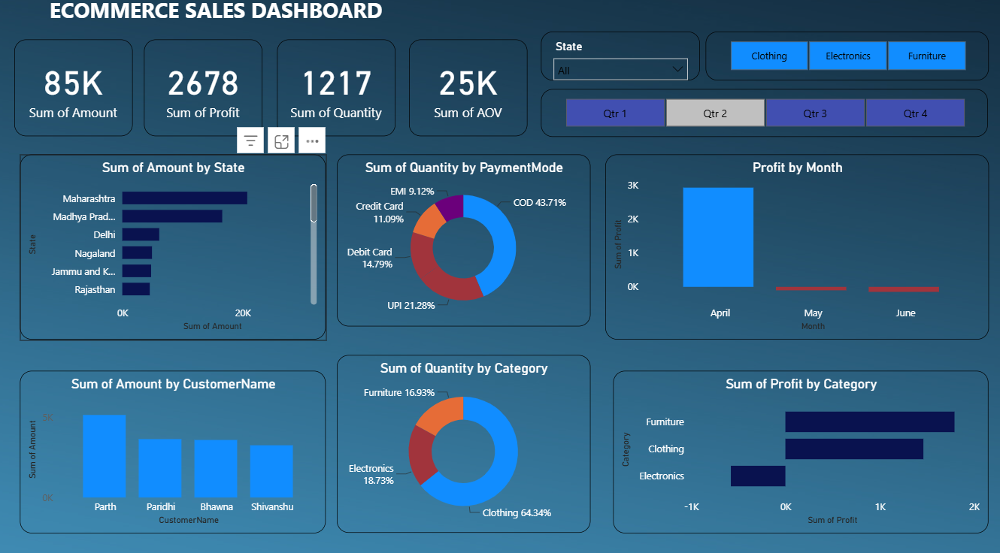
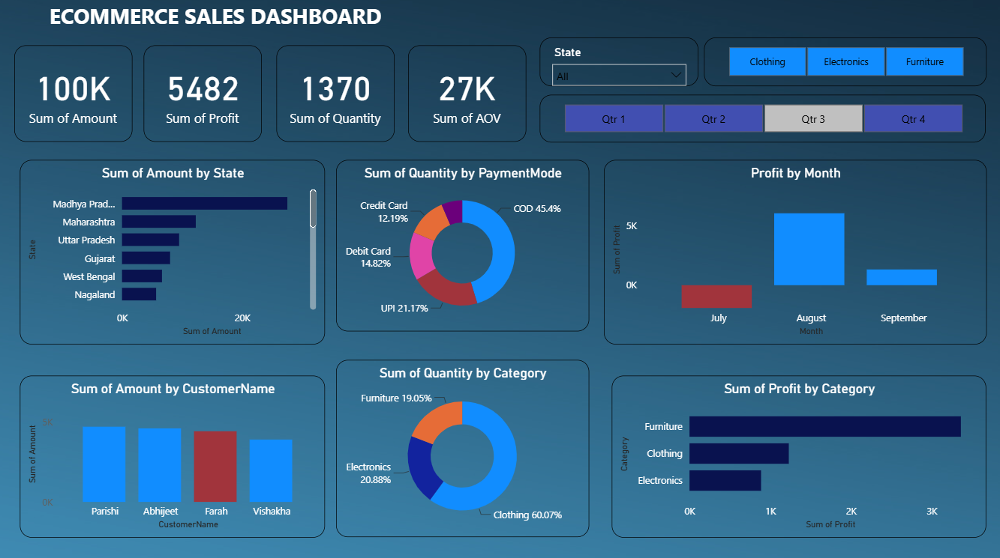
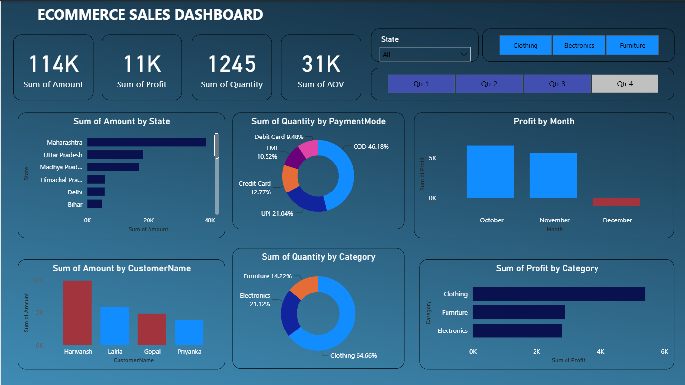

# 📊 Sales Dashboard – Power BI

## 📌 About the Project

The Sales Dashboard is an interactive data visualization project developed using Microsoft Power BI. It provides a clear overview of sales performance through interactive charts, tables, filters and slicers.

The dashboard helps track Key Performance Indicators (KPIs), analyze business trends and support data-driven decision-making.

## 🛠️ Tech Stack

- Microsoft Power BI
- DAX
- Data Visualization
- Interactive Reports

## ✨ Features

- Interactive sales dashboard.
- KPI tracking and performance monitoring.
- Visual representation of sales trends.
- Dynamic filters and slicers.
- Charts and tables for sales analysis.
- Quarterly sales performance analysis.

## 📸 Dashboard Screenshots

### Quarter 1

### Quarter 2

### Quarter 3

### Quarter 4

## 🎥 Project Demo

[▶️ Watch the Sales Dashboard Demo](https://drive.google.com/file/d/14nOmtgHaO5zmmWkjbDFj_o9uW3sMQD6I/view?usp=drive_link)

## 📁 Project Files

| File | Description |
|---|---|
| `sales.pbix` | Power BI dashboard source file |
| `1 qtr.png` | Quarter 1 dashboard screenshot |
| `2qtr.png` | Quarter 2 dashboard screenshot |
| `3qtr.png` | Quarter 3 dashboard screenshot |
| `4qtr.png` | Quarter 4 dashboard screenshot |
| `video.mp4` | Project demonstration video |

## 🎯 Learning Outcomes

- Creating interactive dashboards using Power BI.
- Understanding KPI tracking and performance analysis.
- Working with charts, tables, filters and slicers.
- Presenting sales data through visualizations.
- Supporting data-driven business decisions.

## 👩‍💻 Author

**Sakshi Shimpi**

- GitHub: [sakshishimpi03](https://github.com/sakshishimpi03)
- LinkedIn: [sakshi-shimpi](https://linkedin.com/in/sakshi-shimpi)

---
